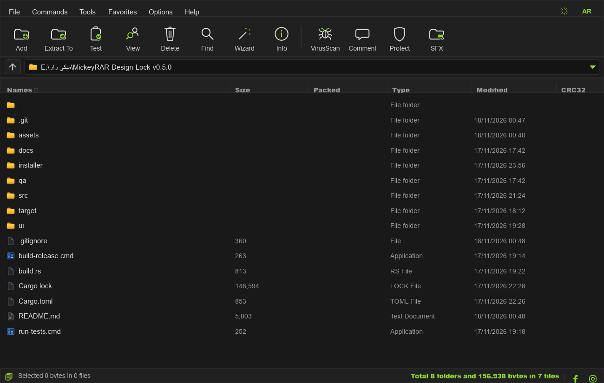
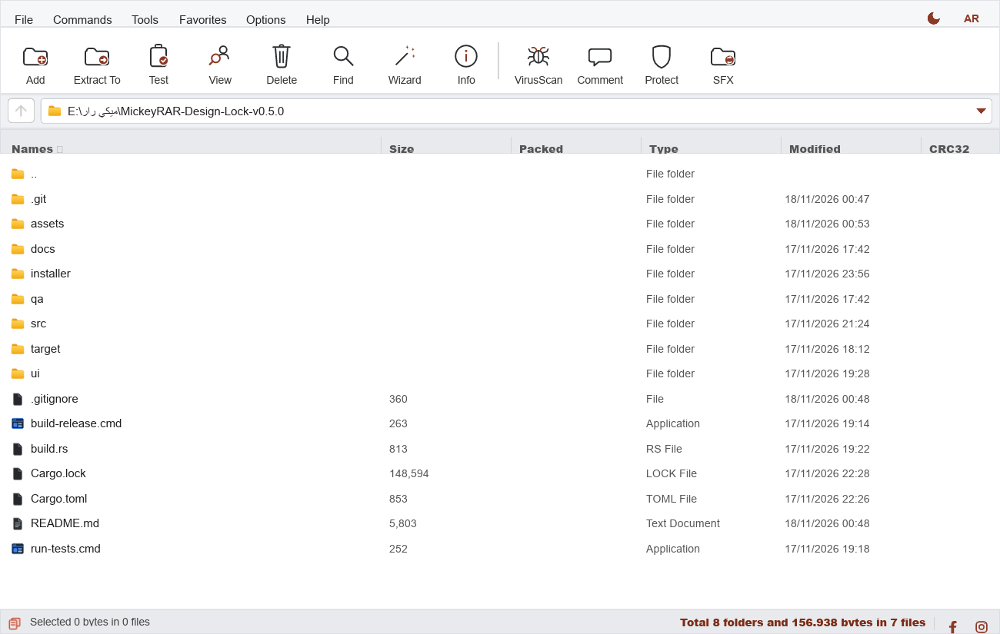

# Mickey RAR (ميكي رار) 🗜️

<p align="center">
  
</p>

<p align="center">
  <b>Modern, High-Performance, WinRAR-inspired Archive Manager built with Rust & Slint.</b><br />
  <b>برنامج إدارة وضغط الملفات العصري فائق الأداء، مستوحى من WinRAR ومبني بلغة Rust وواجهة Slint.</b>
</p>

---

## 📸 Screenshots | لقطات من البرنامج

### Dark Mode (الوضع الداكن الأصلي)


### Light Mode (الوضع الفاتح)


---

## 💾 Download Installer | تحميل البرنامج جاهزاً للتثبيت

You can directly download the pre-compiled standalone Windows installer here:
يمكنك تحميل مثبت البرنامج المستقل لويندوز مباشرة من هنا:

👉 **[Download MickeyRAR-Setup.exe (المثبت الجاهز)](installer/MickeyRAR-Setup.exe)**  
📦 **[Latest Releases on GitHub](https://github.com/Michael-Maged1/MickeyRAR/releases)**

---

## 🌟 Overview | نظرة عامة

**Mickey RAR** is an open-source archive manager designed to provide the familiar and powerful workflow of classic WinRAR combined with a modern Windows 11 Fluent interface, ultra compression (LZMA2), and lightweight native performance.

**ميكي رار** هو برنامج مفتوح المصدر لإدارة الملفات المضغوطة، يجمع بين سهولة وقوة برنامج WinRAR الكلاسيكي مع واجهة عصرية متوافقة مع Windows 11، وأعلى نسب ضغط (LZMA2 Ultra)، وسرعة استجابة فائقة بفضل لغة البرمجة Rust.

---

## ✨ Features | المميزات

* 🎨 **Windows 11 Fluent UI**: True black dark theme (`#191919`) with custom vibrant orange branding (`#E8573F`), plus light mode toggle.
* 🖱️ **Windows Explorer Context Menu (قائمة كليك يمين)**:
  * **Extract Here (فك الضغط هنا)**: One-click instant extraction in the current directory.
  * **Extract to subfolder (استخراج إلى مجلد)**: Creates a dedicated folder named after the archive and extracts inside it.
  * **Extract files... (استخراج إلى...)**: Opens Mickey RAR directly to choose extraction target path.
  * **Add to archive... & Compress to ZIP**: Instant compression shortcuts.
* 🔄 **GitHub Auto-Update System (نظام التحديث التلقائي)**:
  * Automatically checks GitHub Releases on startup in the background.
  * Manual check via `Help -> Check for updates...` (مساعدة -> التحقق من وجود تحديثات...).
  * Informs the user and automatically downloads & launches the installer for updates from `Michael-Maged1/MickeyRAR`.
* 📋 **Authentic WinRAR Menus**:
  * **File (ملف)**: Open archive, choose folder, refresh, select all, invert selection, clear selection, and exit.
  * **Commands (أوامر)**: Add files, extract, test integrity, view files, delete files, protect archive, and SFX.
  * **Tools (أدوات)**: Show archive details, Windows Defender virus scan integration, and 7-Zip hardware benchmark.
  * **Favorites (المفضلة)**: One-click jump to Desktop, Downloads, Documents, and Pictures.
  * **Options (خيارات)**: Ultra LZMA2 compression settings (threads & solid mode), theme toggle, and language switch.
  * **Help (مساعدة)**: Social profile links, GitHub updates, and About dialog.
* 🌐 **Bilingual Interface**: Seamless instant switching between **العربية** (Arabic) and **English**.
* ⚡ **Ultra LZMA2 & ZIP Engine**: Multi-threaded compression supporting levels 0–9 with solid block optimization.
* 🛡️ **Windows Defender Integration**: One-click background virus scanning directly from the Tools menu.
* 📊 **Hardware Benchmark**: Built-in CPU & RAM compression performance test reporting real-time MIPS ratings.
* 🔗 **Social Integration**: Direct social shortcuts to Facebook & Instagram in the status bar.
* 📦 **Single-file Standalone Setup**: Self-contained graphical installer built right in `installer/MickeyRAR-Setup.exe`.

---

## 📁 Project Structure | هيكل المشروع

```text
├── assets/                     # Icons, window branding, and screenshots
│   ├── icons/                 # Dark mode SVGs (brand orange #E8573F)
│   ├── icons-light/           # Light mode SVGs
│   ├── icon.png               # High resolution app icon
│   ├── screenshot-dark.png    # Modern dark mode interface capture
│   └── screenshot-light.png   # Light mode interface capture
├── docs/                       # Specifications, architecture, and feature mapping
├── installer/                  # Standalone installer & uninstaller source
│   ├── MickeyRAR-Setup.exe    # Pre-compiled standalone graphical installer
│   ├── installer_gui.rs       # GUI installer embedding the release executable
│   ├── uninstaller.rs         # Clean uninstallation tool
│   └── runtime/               # Bundled 7z runtime engine
├── src/                        # Rust backend source
│   ├── main.rs                # Application entry, state, and menu dispatch
│   ├── engine.rs              # 7-Zip engine wrapper, path safety, & compression
│   ├── i18n.rs                # Arabic / English localization
│   └── winicon.rs             # Windows window icon hook
├── ui/                         # Slint declarative UI
│   └── main.slint             # UI layout, toolbar, table, and dropdown menus
├── Cargo.toml                  # Dependencies & build configuration
└── README.md
```

---

## 🚀 Building & Running | طريقة البناء والتشغيل

### Prerequisites | المتطلبات
1. **Rust & Cargo** (1.75 or later): [Install Rust](https://www.rust-lang.org/tools/install)
2. **Windows 10 / 11** (64-bit recommended)

### Run in Development
```bash
cargo run
```

### Run Unit Tests
```bash
cargo test
```

### Build Optimized Release Binary
```bash
cargo build --release
```
The optimized executable will be generated at `target/release/mickey-rar.exe`.

### Build Installer
```cmd
installer\build-installer.cmd
```
This generates the standalone `installer/MickeyRAR-Setup.exe`.

---

## 🛡️ License | الترخيص

Distributed under the **MIT License**. See `Cargo.toml` for details.

---

## 👨‍💻 Developer | المطور

Developed by **Michael Maged (مايكل ماجد)**
- GitHub: [Michael-Maged1](https://github.com/Michael-Maged1)
- Facebook: [michaelmagedm](https://www.facebook.com/michaelmagedm)
- Instagram: [@michaelmagedm](https://www.instagram.com/michaelmagedm/)
